[简体中文](README.md) · **English**

#  Py-Apple Dog 5 · Open-source AI Quadruped

**Start from scratch and learn to train and deploy your own robot with reinforcement learning.**

Py-Apple Dog 5 is the fifth-generation open-source quadruped in the Py-Apple Dog family, introduced in 2026 by [OpenSpark Lab](https://space.bilibili.com/493192058). It has **12 actuated joints, with 3 degrees of freedom per leg**, a body and wheeled leg structure you can print and assemble yourself, and reinforcement learning policies for trotting, walking, bounding, and self-righting. With the matching firmware and peripherals, these policies can be deployed on a **low-cost ESP32 controller**.

The robot uses policies trained in [MJLab](https://github.com/mujocolab/mjlab) simulation to turn its current state and motion commands into joint control. This project takes you through mechanical assembly, reinforcement learning, and deployment on a real robot, while introducing tools that make it easier to bring motion policies to your own robots.

The project provides **[printable STL models](stl/), [open policies](policies/README.en.md), [training instructions](training/README.en.md), and [pretrained policy files](policies/README.en.md)**, along with **[open-source hardware circuit designs](hardware/README.en.md)**, supporting the full process from building the structure to training, simulation, and deployment.

- **Print and assemble:** STL files cover the body, shoulders, thighs, and complete wheeled lower legs.
- **Train policies:** Load the Py-Apple Dog example in **[StackForce SimReady](https://sim.stackforce.cc/) (MJLab reinforcement learning project generator)**, train your own policy, and inspect it in playback.
- **Validate in simulation:** Run a matching model and policy in **[StackForce Sim2Sim](https://sim2sim.stackforce.cc/) (browser-based MuJoCo simulator, no installation required)** to observe its gait and motion.
- **Deploy on hardware:** Use **[StackForce Sim2Real](https://sim2real.stackforce.cc/) (general-purpose web tool for deploying reinforcement learning policies)** to configure joints, calibrate zero positions, and deploy the policy.

<table id="pineapple-hero">
<tr>
<td width="50%" align="center" valign="middle">
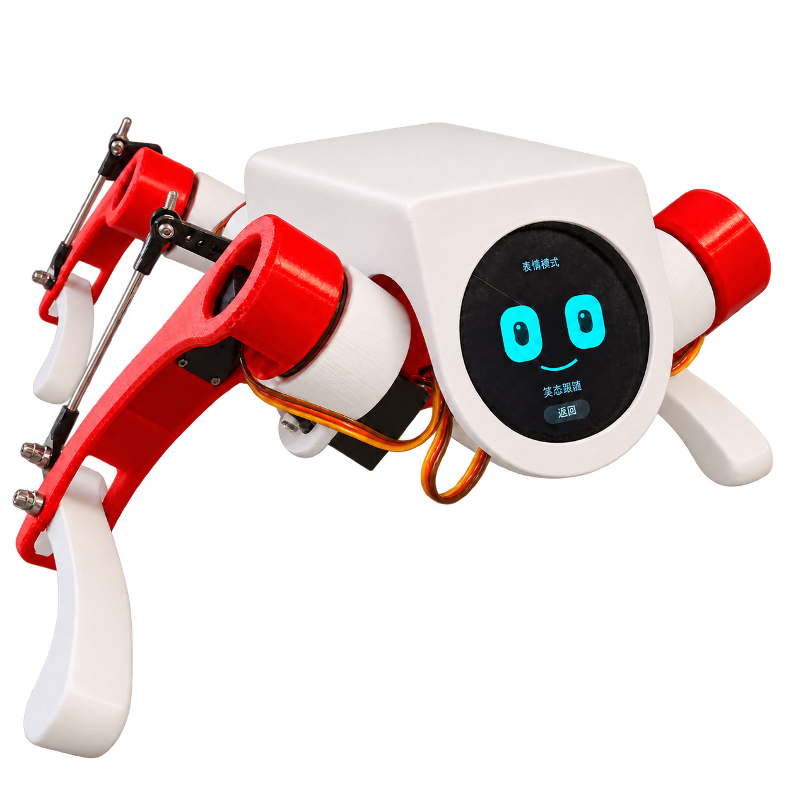
</td>
<td width="50%" align="center" valign="middle">

Forward and backward walking

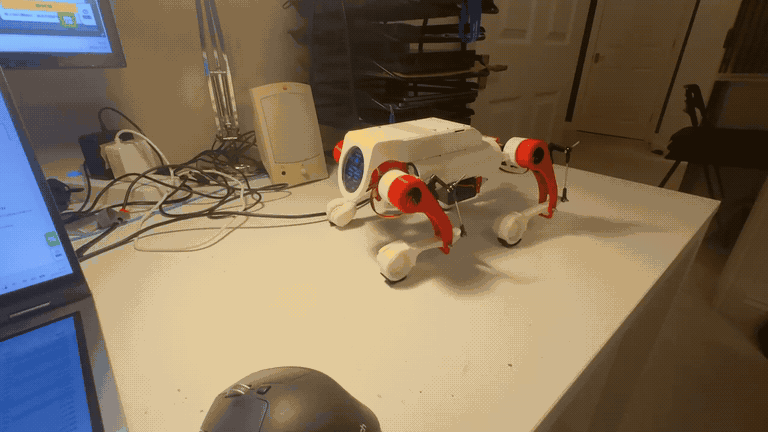

Self-righting

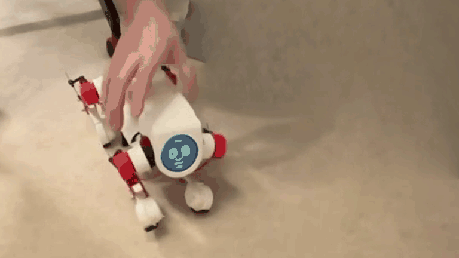
</td>
</tr>
</table>

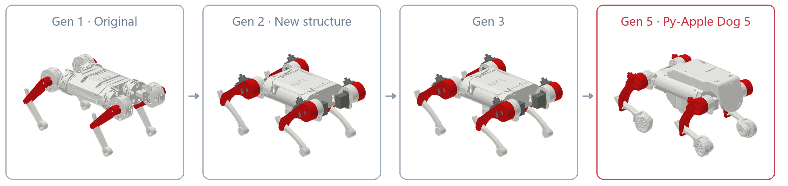

## Available gaits and actions

**Four locomotion gaits and one self-righting action** are currently available: forward trot, omnidirectional trot, slow walk, bound, and recovery from a fall. The GIFs below show the corresponding policies in simulation. A roller-skating gait is planned for a future release.

| Gait or action | Simulation GIF | Behavior | Availability |
| :---: | :---: | :---: | :---: |
| Forward trot | 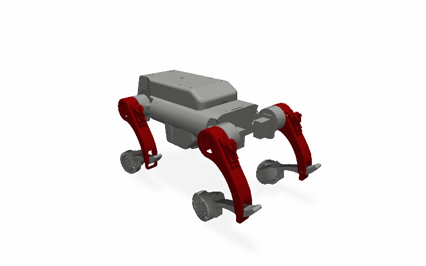 | Standing, forward trotting, and starting/stopping | Available |
| Omnidirectional trot | 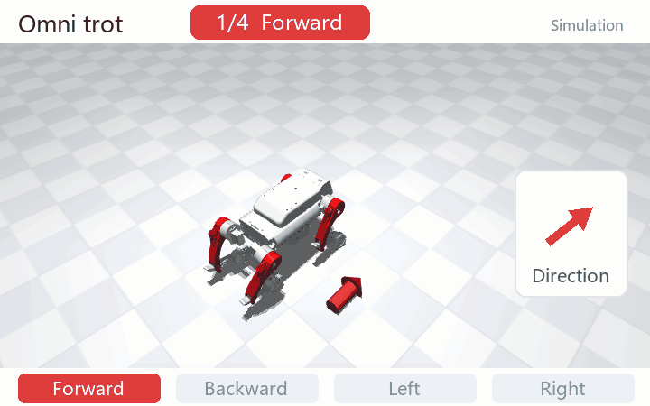 | Forward, backward, left, and right motion; arrows indicate the direction | Available |
| Slow walk | 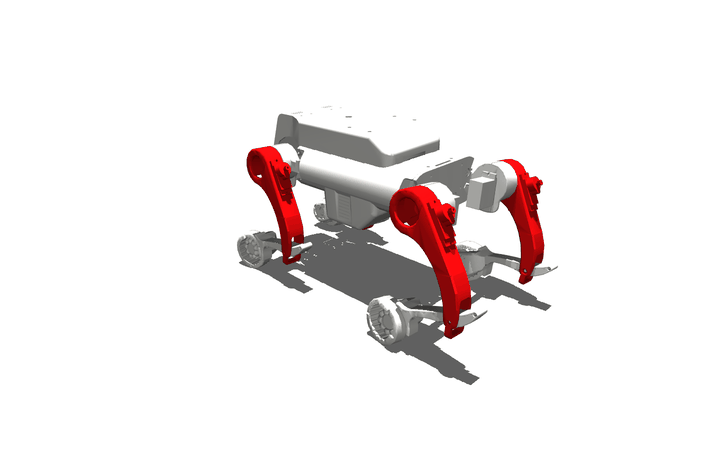 | Slow movement for observing leg motion and footfall order | Available |
| Bound | 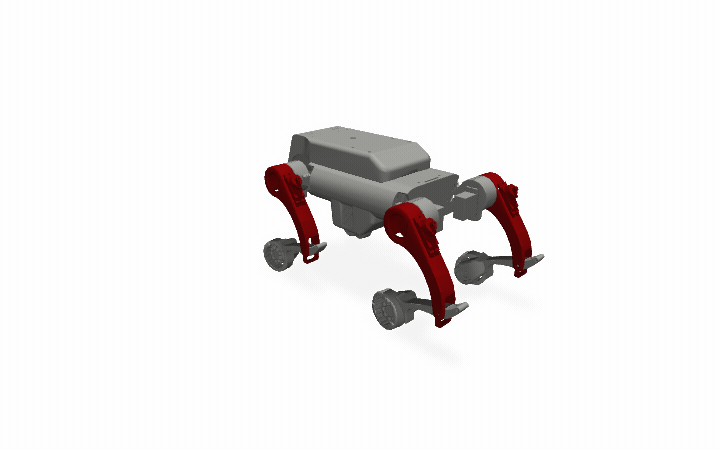 | Paired-leg bounding | Available |
| Self-righting | 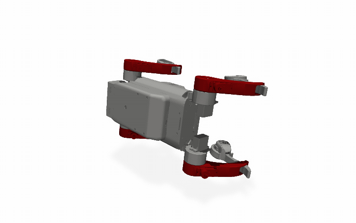 | Recovery and posture adjustment after a fall | Available |
| Roller-skating | Demo to be added with the release | Skating with the wheeled lower legs | Planned |

Visit the [StackForce Sim2Sim online MuJoCo simulation platform](https://sim2sim.stackforce.cc/) to try Py-Apple Dog in your browser. Explore its different gaits and evaluate how its reinforcement learning policies run in simulation.

[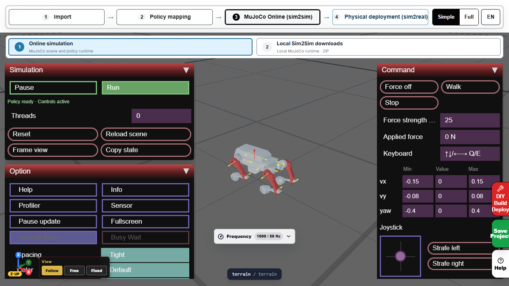](https://sim2sim.stackforce.cc/)

“Available” refers to examples currently selectable on the website. Their ONNX policies and complete `.sim` projects are included in the [policy directory](policies/README.en.md). For physical deployment, use a project that matches your structure, servos, controller, and calibration. See the [compatibility notes](docs/COMPATIBILITY.en.md).

## Build your own Py-Apple Dog

Build your Py-Apple Dog in three steps:

1. **[Print and assemble](#diy-print):** Print the structural parts and assemble the body, joints, and control hardware.
2. **[Deploy a pretrained policy](#diy-deploy):** Connect the ESP32, calibrate the joints, and upload a matching policy to get your robot moving.
3. **[Train your own policy](#diy-train):** Configure and train a policy in SimReady, evaluate its motion, and deploy it on your robot.

To help you build Py-Apple Dog and get it moving, we developed a **robot reinforcement learning development toolchain** covering mechanical model calibration, reinforcement learning project generation and training, simulation validation, and deployment on real hardware.

Start with a STEP/STP mechanical model, configure links, joints, and motion parameters, and generate a URDF model for simulation and training with [StackForce STP to URDF](https://cad2urdf.stackforce.cc/). Then map the model to the policy interface and generate an MJLab or Isaac Gym reinforcement learning project with [StackForce SimReady](https://sim.stackforce.cc/).

Once a policy is trained, import the model and policy into browser-based MuJoCo using [StackForce Sim2Sim](https://sim2sim.stackforce.cc/). Observe its gait, stability, and response to disturbances. Next, use [StackForce Sim2Real](https://sim2real.stackforce.cc/) for joint configuration, zero calibration, policy upload, and physical deployment.

These tools also support robots you design yourself. Learning this workflow gives you a path from your own mechanical model through training and simulation to real-world motion, bringing reinforcement learning to more DIY robots.

[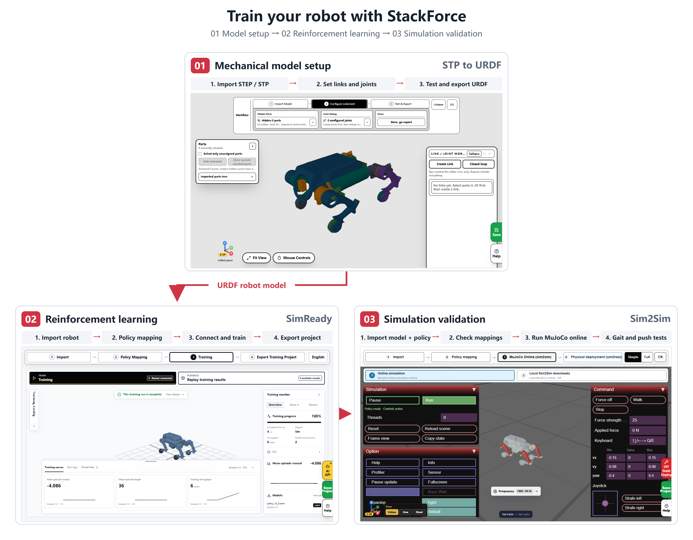](docs/stackforce-training-workflow.en.png)

**[Download STL](stl/) · [Printing and assembly](docs/PRINTING.en.md) · [Policy training](training/README.en.md) · [Sim2Sim validation](https://sim2sim.stackforce.cc/) · [Sim2Real deployment](https://sim2real.stackforce.cc/) · [Previous versions](legacy/README.en.md)**

### Step 1: Print and assemble

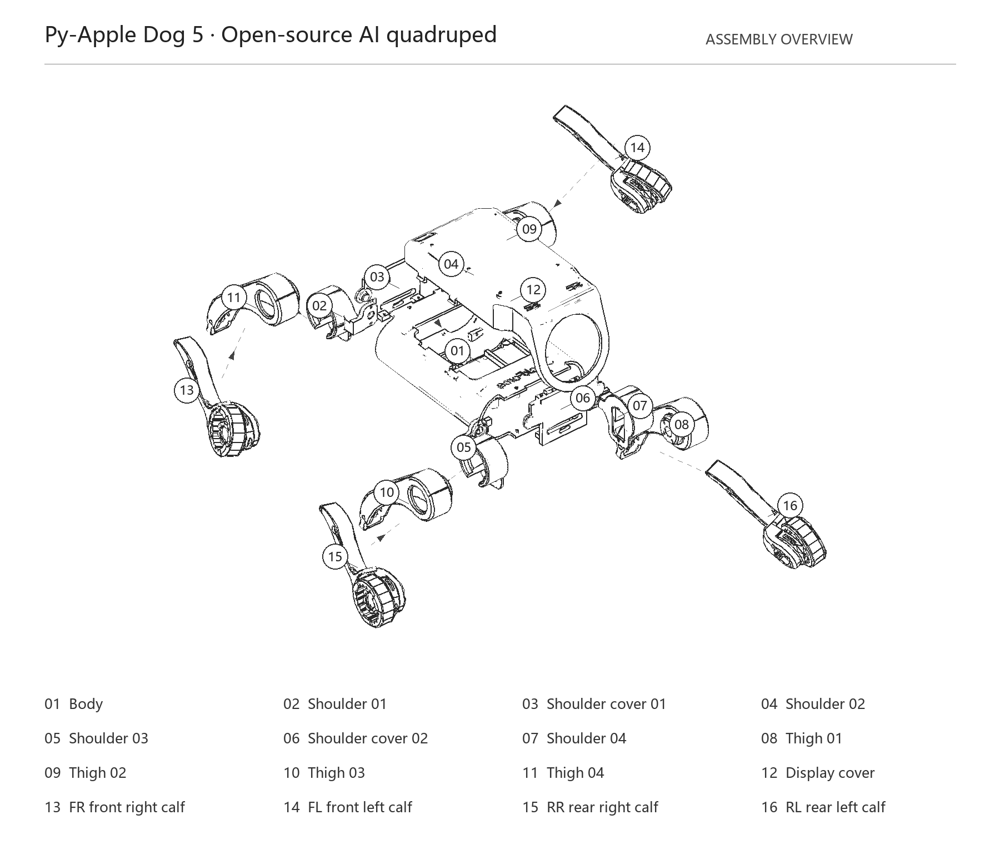

Start with your first printed part and build your own fifth-generation Py-Apple Dog. This repository provides **[printable STL models](stl/) and [printing and assembly instructions](docs/PRINTING.en.md)**. The printing directory contains **16 STL files**:

| Part | Quantity |
| :---: | :---: |
| Body | 1 |
| Shoulders | 4 |
| Shoulder covers | 2 |
| Thighs | 4 |
| Display top cover | 1 |
| Complete lower legs, including wheels | 4 |

Import the files into your slicer in **millimeters at 100% scale**. Print each lower leg from its complete STL file; do not separate the lower leg and wheel into individual print files. Assemble the legs with **all four wheels facing outward**.

Use the exploded view and print list to fit the structural parts, servos, bearings, and control electronics.

**[Download STL](stl/) · [Print list](docs/print-list.en.csv) · [Printing and assembly notes](docs/PRINTING.en.md)**

### Step 2: Deploy a reinforcement learning policy

#### Hardware connections

Connect the [Zero core board](hardware/README.en.md) and [HAT](hardware/README.en.md), then attach the BNO055, PCA9685, and round display to the HAT.

**[View hardware connections: wiring diagram, pin order, and power →](docs/WIRING.en.md)**

#### Upload and run the policy

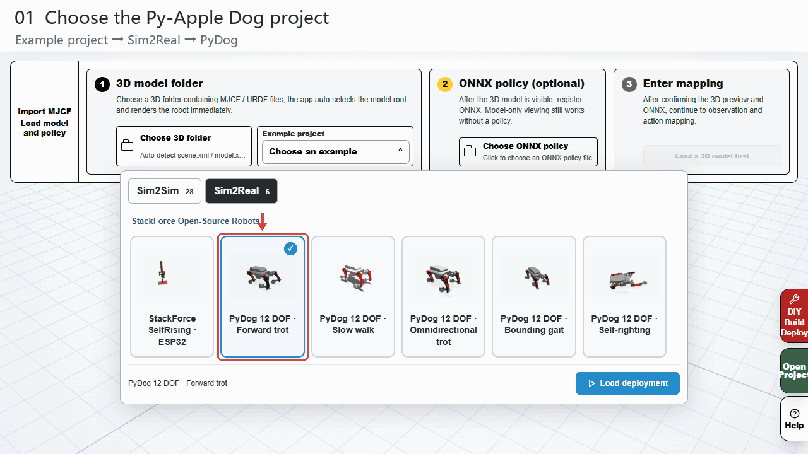

This GIF uses a simulated device to demonstrate USB connection, joint mapping, policy upload, and startup. Calibrate your own hardware after assembly.

Open [StackForce Sim2Real](https://sim2real.stackforce.cc/) and select a project that matches Py-Apple Dog 5 and your hardware.

1. **Connect the controller:** Set up the firmware, controller board, and servo connections for your hardware.
2. **Calibrate the joints:** Check the order, direction, zero position, and range of all 12 joints.
3. **Check motion gradually:** Test individual joints, a single leg, and then standing to verify assembly and calibration.
4. **Deploy the policy:** Select “Upload and run”, follow the validation and startup steps, and use the remote-control panel to view status and operate the robot.

Keep the model, hardware, and policy configuration consistent. See the [compatibility notes](docs/COMPATIBILITY.en.md).

#### Running on real hardware

### Step 3: Train your own policy with SimReady

[StackForce SimReady](https://sim.stackforce.cc/) is a robot reinforcement learning configuration and training tool developed by OpenSpark Lab. Load a robot in the browser, inspect or adjust observations, actions, rewards, and training parameters, then connect a local runner to train, replay, and save models.

Start with this introduction to SimReady:

[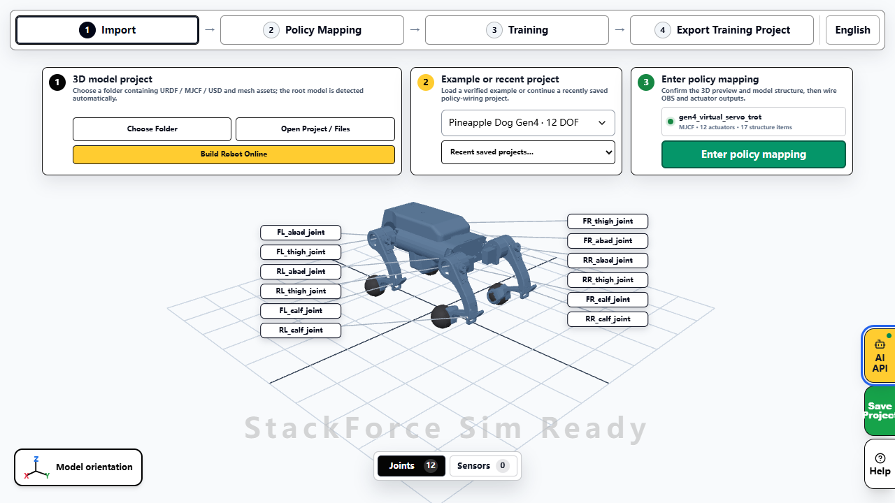](https://www.bilibili.com/video/BV1kVRzBEE2g/)

**▶ [Bilibili: Turning a robot URDF into an Isaac Lab reinforcement learning project](https://www.bilibili.com/video/BV1kVRzBEE2g/)**

The matching example is still listed in SimReady as **“Pineapple Dog Gen4 · 12 DOF”**. You can start with its existing model and configuration. The repository also includes a [forward-gait training package](training/README.en.md) with a loadable `.simready` project, an MJLab training project, and parameter files.

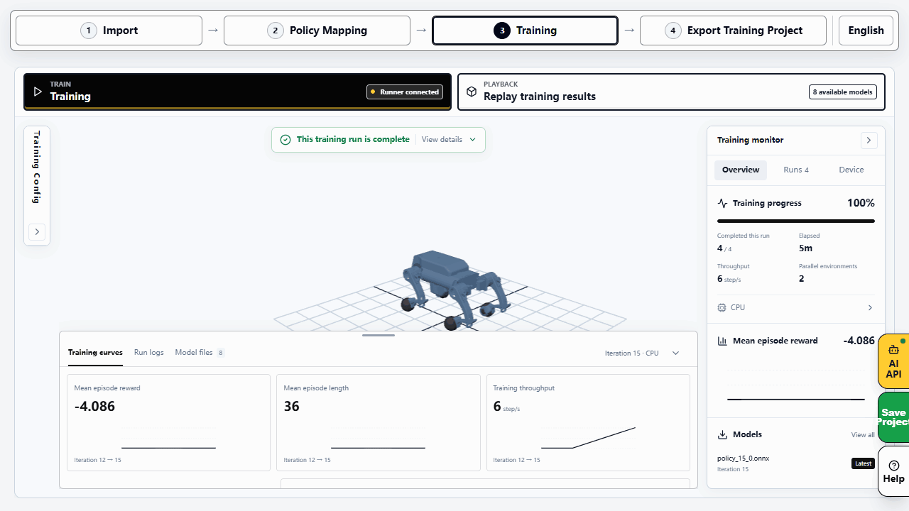

1. **Load the example:** Select “Pineapple Dog Gen4 · 12 DOF” in SimReady and load it.
2. **Inspect the policy mapping:** Review observations, actions, and joint mappings. Keep the example defaults for your first run.
3. **Connect a local runner:** In the training step, download and start the runner using the website instructions, then connect it. Computation runs on your computer; the browser provides configuration and monitoring.
4. **Train and replay:** Start with the small-scale validation option, then choose a training scale suitable for your computer. Watch the curves and replay saved models to inspect their motion.
5. **Save and review:** Save the project and checkpoints, check playback in SimReady, and verify the observations, actions, and joint configuration required for simulation and deployment.

**[Open SimReady](https://sim.stackforce.cc/) · [Training walkthrough](docs/TRAINING.en.md) · [Forward-gait training package](training/README.en.md)**

## Repository navigation

| Directory | Contents |
| :---: | :---: |
| `stl/` | Printable parts for Py-Apple Dog 5 |
| `docs/` | Printing, assembly, training, and compatibility notes |
| `legacy/` | Entry point for previous Py-Apple Dog versions |

## Previous Py-Apple Dog versions

Py-Apple Dog 5 is the fifth-generation entry point for this repository.

Earlier Py-Apple Dog robots using traditional motion control, along with their tutorials and mechanical, electronic, and software resources, remain in the [original repository](https://github.com/ToanTech/py-apple-quadruped-robot). The fifth generation is maintained independently here; see [previous versions](legacy/README.en.md) for the other project repositories.

## Contribute

Share your builds, printing experience, structural improvements, and reinforcement learning experiments.

Project videos and tutorials: [OpenSpark Lab on Bilibili](https://space.bilibili.com/493192058).

When reporting an issue, include the structural version, hardware configuration, policy name, and relevant photos, videos, or logs so others can understand and reproduce it.
