**简体中文** · [English](README.en.md)

#  菠萝狗 5 · 开源 AI 四足机器人

**从零开始，带你学会用强化学习训练和部署你自己的机器人。**

菠萝狗 5 是菠萝狗系列的第五代开源四足机器人，由[灯哥开源（OpenSpark Lab）](https://space.bilibili.com/493192058)于 2026 年推出。它采用 **12 个主动关节，每条腿具有 3 个自由度**，配合可自行打印、装配的机身和带轮腿部结构，通过强化学习运动策略完成小跑、慢行、跳跃和翻倒自起立等动作。配合相应的控制固件与外设，使用低成本的 **ESP32 主控**即可部署运行匹配的运动策略。

机器人使用在 [MJLab](https://github.com/mujocolab/mjlab) 仿真中训练好的策略，根据自身状态，通过运动控制指令控制各个关节。通过这个项目，你可以学会从机械搭建、强化学习训练到实物部署的完整流程，并掌握一系列机器人快速开发工具，更方便地将运动策略部署到自己的机器人上。

项目提供 **[STL 打印模型](stl/)、[开源策略](policies/)、[配套训练方法](training/README.md)及[训练好的策略文件](policies/)**，并开源 **[硬件电路](hardware/README.md)**，支持从结构搭建、策略训练、仿真验证到实物部署的完整学习过程。

- **结构打印**：提供机身、肩部、大腿及整体带轮小腿等 STL 文件，供自行打印与装配。
- **策略训练**：在 **[StackForce SimReady](https://sim.stackforce.cc/)（MJLab 强化学习工程生成器）** 中载入菠萝狗配套示例，训练自己的策略，并通过回放检查动作效果。
- **仿真验证**：通过 **[StackForce Sim2Sim](https://sim2sim.stackforce.cc/)（MuJoCo 网页在线免安装仿真器）** 运行匹配的模型与策略，观察步态和运动表现。
- **实物部署**：通过 **[StackForce Sim2Real](https://sim2real.stackforce.cc/)（强化学习通用实物部署网页工具）** 完成关节配置、零位标定和策略部署，让真实机器人动起来。

如果在搭建、训练或实物部署中遇到问题，欢迎加入灯哥开源社区交流：**强化学习 QQ 交流群：1056677085**。

如果你想省去逐项选型、采购元器件的麻烦，也可以直接选购我们准备的 **菠萝狗套件**，一键配齐，从装配开始，把更多时间留给强化学习训练和机器人实物部署。

**[淘宝商品页 →](https://item.taobao.com/item.htm?abbucket=0&id=1099953034601) · [淘宝快捷链接 →](https://e.tb.cn/h.jkGIwebE57o3m0y?tk=zrA164ws3jW)**

<table id="pineapple-hero">
<tr>
<td width="50%" align="center" valign="middle">
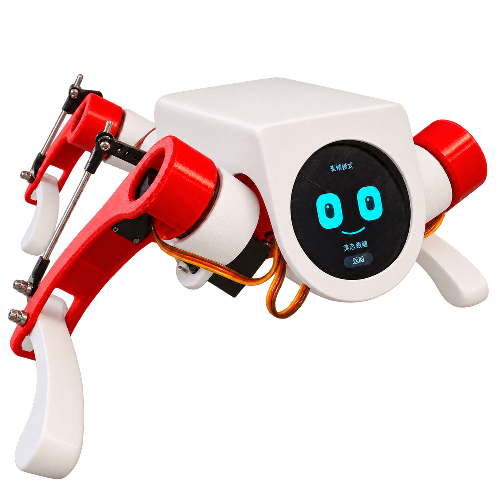
</td>
<td width="50%" align="center" valign="middle">

前后行走

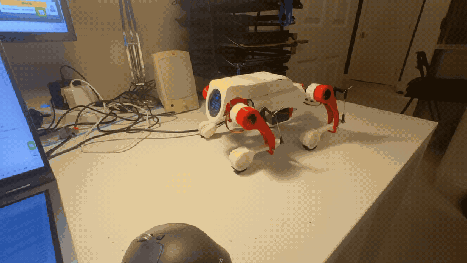

摔倒自起立

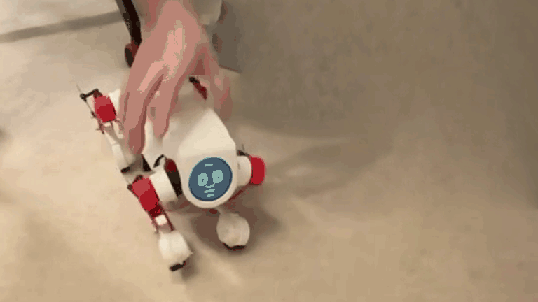
</td>
</tr>
</table>

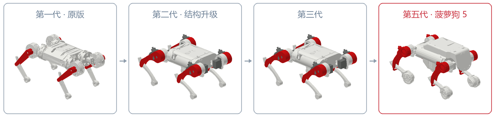

## 当前开放的步态与动作

目前已经开源 **4 类运动步态和 1 项翻倒恢复动作**，包括向前小跑、全向小跑、慢行、跳跃和翻倒自起立。以下 GIF 展示对应策略的仿真效果，轮滑步态将在后续开放。

| 步态或动作 | GIF 演示（仿真） | 主要内容 | 状态 |
| :---: | :---: | :---: | :---: |
| 向前小跑 | 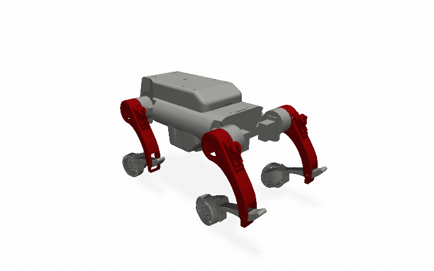 | 站立、向前小跑及启停 | 已开放 |
| 全向小跑 | 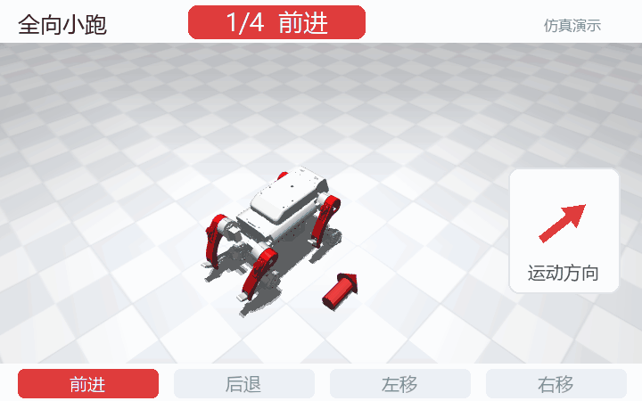 | 前进、后退、左移、右移，箭头标出运动方向 | 已开放 |
| 慢行步态 | 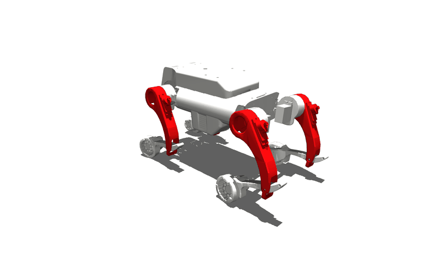 | 慢速行走，观察腿部动作与落足顺序 | 已开放 |
| 跳跃步态 | 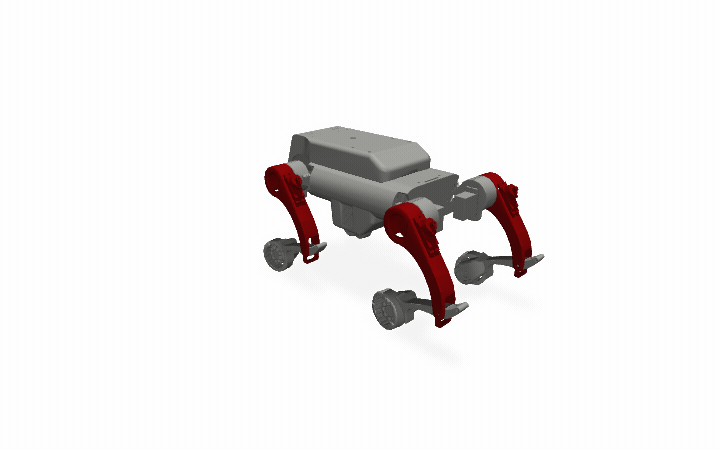 | Bound 成组跳跃 | 已开放 |
| 翻倒自起立 | 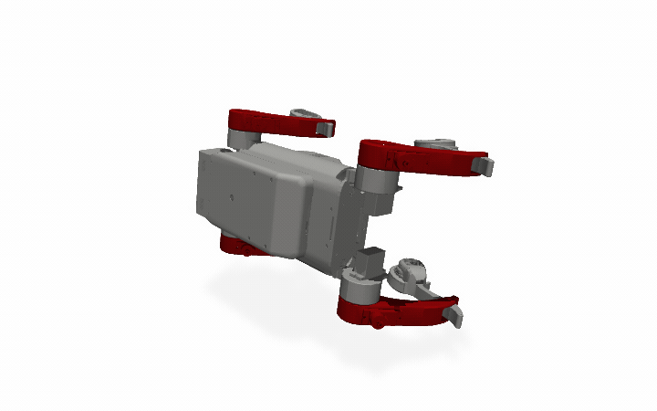 | 翻倒后的恢复起立与姿态调整 | 已开放 |
| 轮滑步态 | 演示将随后续开放补充 | 利用带轮小腿开展轮滑运动 | 后续开放 |

点击进入 [StackForce Sim2Sim MuJoCo 在线仿真平台](https://sim2sim.stackforce.cc/)，体验菠萝狗在线仿真。你可以在这里在线试玩各种步态，检验菠萝狗强化学习策略的部署效果。

[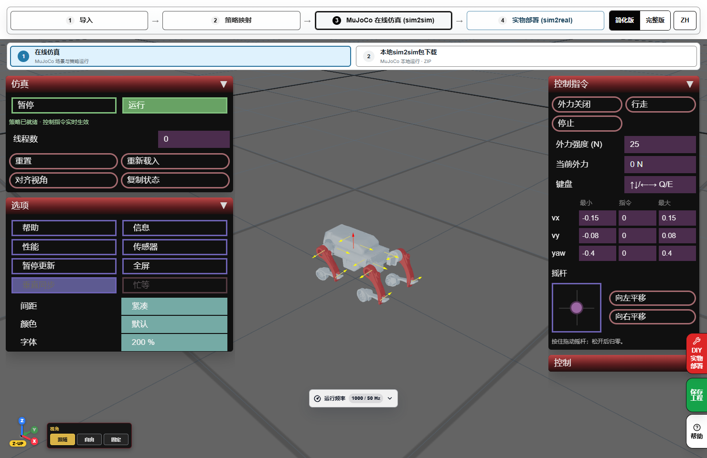](https://sim2sim.stackforce.cc/)

上述“已开放”指网站当前可选择的示例，对应的 ONNX 策略和完整 `.sim` 工程已收录于[策略目录](policies/README.md)。实机运行时，选择与你的结构、舵机、控制板与标定配置匹配的工程，具体对应关系见[版本对应说明](docs/COMPATIBILITY.md)。

## 开始 DIY 一台菠萝狗

DIY 一台菠萝狗，可以按下面三步开始：

1. **[打印与装配](#diy-print)**：打印结构件，完成机身、关节与控制硬件的装配。
2. **[部署现成策略](#diy-deploy)**：连接 ESP32，完成关节标定，上传配套策略，让菠萝狗先动起来。
3. **[训练自己的策略](#diy-train)**：用 SimReady 配置并训练策略，验证动作效果，再部署到自己的机器人上。

为了方便大家把菠萝狗搭建起来、跑起来，我们还专门研发了一整套 **机器人强化学习开发工具链**，覆盖从机械三维模型标定、强化学习工程生成与策略训练，到仿真验证和实物部署的完整流程。

你可以从 STEP / STP 机械三维结构图开始，配置和标定连杆、关节及运动参数，生成可用于仿真与训练的 URDF 机器人模型（[StackForce STP to URDF](https://cad2urdf.stackforce.cc/)）；再完成模型与策略映射，一键生成 MJLab 或 Isaac Gym 强化学习工程，配置并训练自己的运动策略（[StackForce SimReady：强化学习工程生成器](https://sim.stackforce.cc/)）。

有了训练好的策略，就可以将模型与策略导入网页中的 MuJoCo 环境，在线部署和运行，观察步态、运动稳定性以及扰动下的表现，开展仿真与鲁棒性验证（[StackForce Sim2Sim](https://sim2sim.stackforce.cc/)）；随后通过网页完成关节配置、零位标定、策略在线上传与实物部署（[StackForce Sim2Real](https://sim2real.stackforce.cc/)）。

这些工具同样适用于大家自行设计、制作的其他机器人。学会这套流程后，你可以从自己的机械模型出发，逐步完成建模、强化学习训练、仿真验证与实物部署，把强化学习用到更多自制机器人上。

[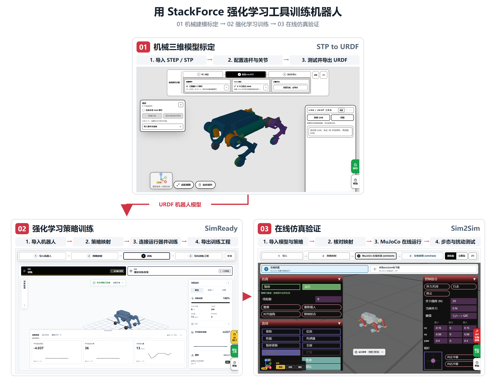](docs/stackforce-training-workflow.png)

**[下载 STL](stl/) · [打印与装配](docs/PRINTING.md) · [策略训练](docs/TRAINING.md) · [Sim2Sim 仿真验证](https://sim2sim.stackforce.cc/) · [Sim2Real 实机部署](https://sim2real.stackforce.cc/) · [历史版本](legacy/README.md)**

### 第一步：打印与装配

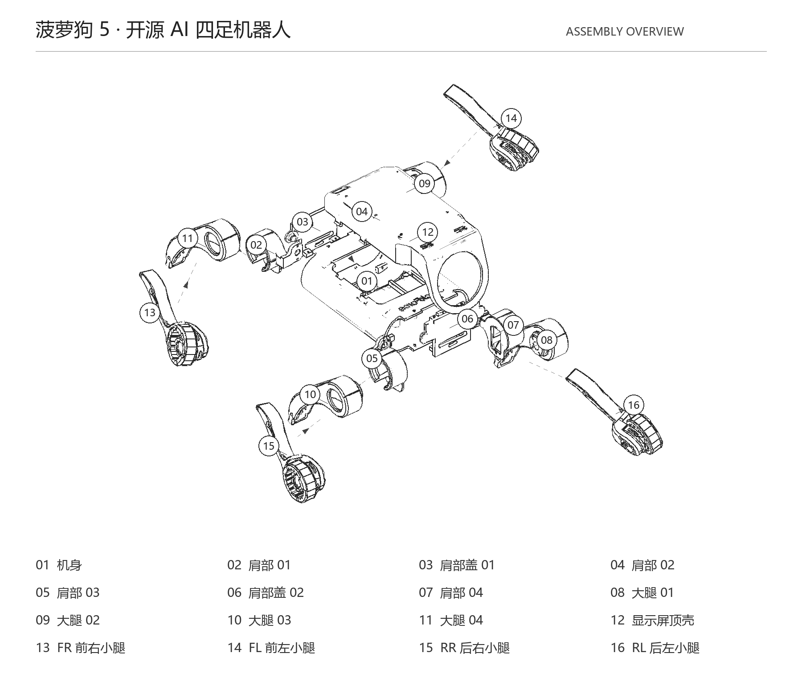

从打印第一块结构件开始，搭建你自己的第五代菠萝狗。本仓库提供 **[STL 打印模型](stl/)及[配套说明资料](docs/PRINTING.md)**，打印目录共 **16 个文件**：

| 结构 | 数量 |
| :---: | :---: |
| 机身 | 1 |
| 肩部 | 4 |
| 肩部盖 | 2 |
| 大腿 | 4 |
| 显示屏顶壳 | 1 |
| 整体小腿（含轮子） | 4 |

导入切片软件时，请使用 **毫米单位、100% 比例**。四条小腿使用提供的整体 STL 直接打印，不拆成小腿件和轮子分别打印。装配时，**四个轮子均朝向腿部外侧**。

对照爆炸图与打印清单，完成结构件、舵机、轴承及控制电子的安装。

**[下载 STL](stl/) · [打印清单](docs/print-list.csv) · [打印与装配说明](docs/PRINTING.md)**

### 第二步：强化学习策略实物部署

#### 硬件连接

先连接 [Zero 核心板](hardware/README.md)与 [HAT](hardware/README.md)，再将 BNO055、PCA9685 和圆形屏幕接到 HAT。

**[点击查看硬件连接：接线图、接口针序与供电说明 →](docs/WIRING.md)**

#### 上传并运行策略

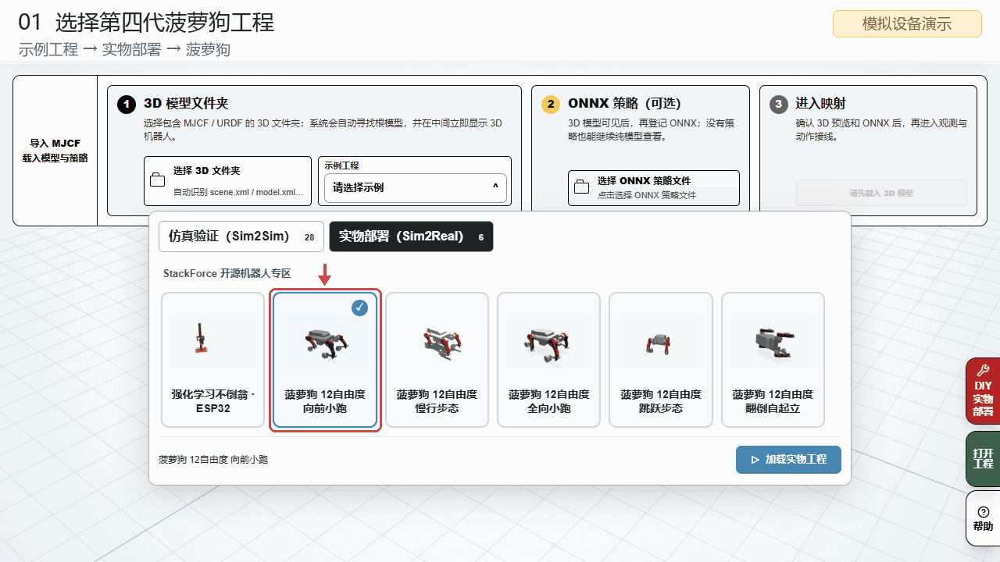

上图使用模拟设备演示 USB 连接、关节映射、策略上传与启动流程；实际装配后请按自己的硬件逐一标定。

机械装配完成后，进入 [StackForce Sim2Real](https://sim2real.stackforce.cc/)，选择与第五代菠萝狗及所用硬件匹配的工程，将运动策略部署到真实机器人。

1. **连接设备**：按对应硬件的说明配置控制固件、板卡与舵机连接。
2. **关节标定**：核对 12 个关节的顺序、转动方向、零位和运动范围。
3. **逐步检查**：依次完成单关节、单腿和站立测试，确认装配及标定结果。
4. **部署策略**：点击“上传并运行”，按网页完成策略核验与启动，再在“遥控操作”中查看状态和控制机器人。

模型、硬件与策略需要保持对应，具体记录见[版本对应说明](docs/COMPATIBILITY.md)。

#### 实机运行演示

### 第三步：用 SimReady 训练自己的策略

[StackForce SimReady](https://sim.stackforce.cc/) 是灯哥开源开发的机器人强化学习工程配置与训练工具。你可以在网页中载入机器人，查看与调整观测、动作、奖励和训练参数，再连接本地运行器进行训练、回放和保存模型。

先看这段视频，了解 SimReady 的使用方式：

[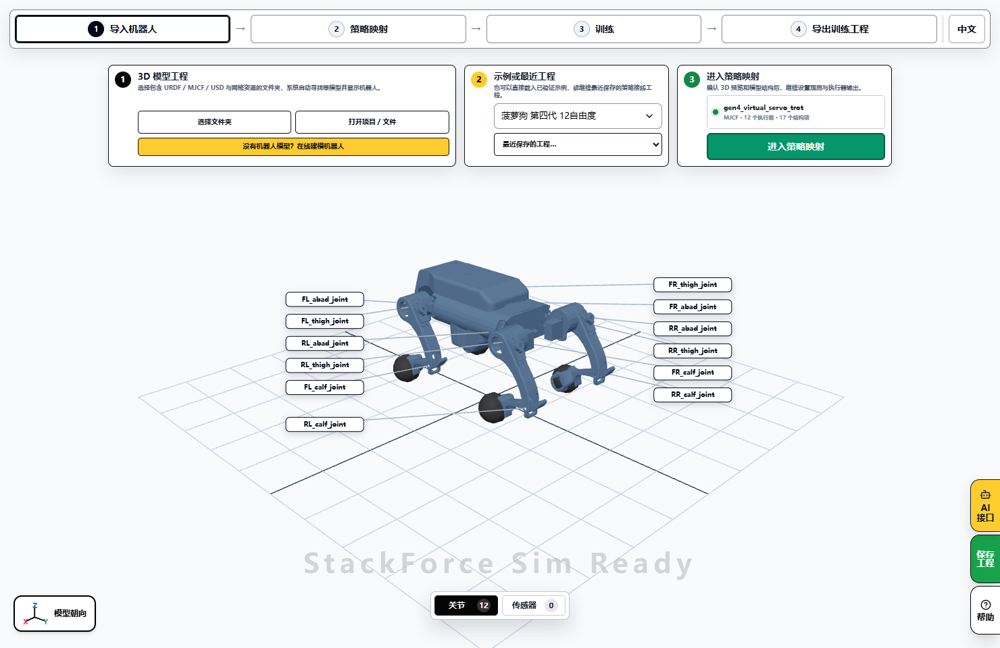](https://www.bilibili.com/video/BV1kVRzBEE2g/)

**▶ [B 站视频：我做了个工具，机器人 URDF 秒转 Isaac Lab 强化学习工程](https://www.bilibili.com/video/BV1kVRzBEE2g/)**

配套示例在 SimReady 中仍显示为 **“菠萝狗 第四代 12自由度”**，可以直接从已有的模型与训练配置开始。仓库也提供[前行步态训练资料](training/README.md)，包含可直接载入的 `.simready` 工程、MJLab 训练工程和参数文件。

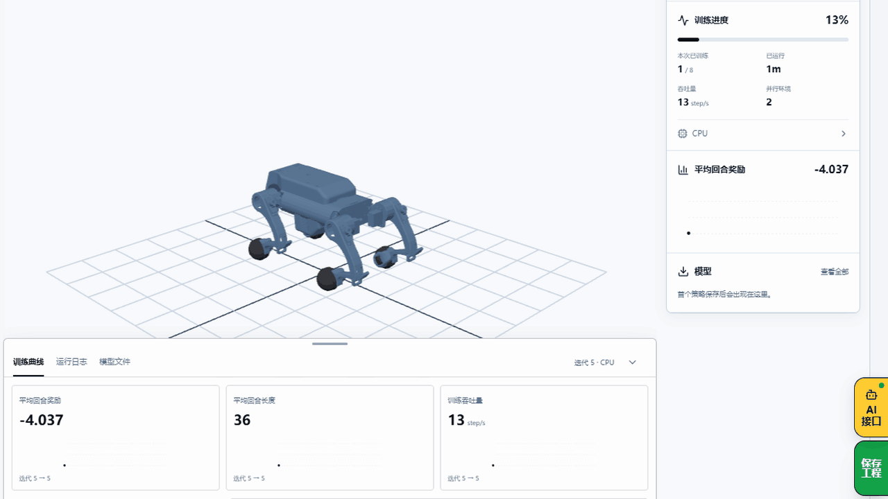

1. **载入菠萝狗示例**：进入 SimReady，在示例列表中选择“菠萝狗 第四代 12自由度”，点击“加载示例”。
2. **查看策略配置**：进入“策略映射”，了解示例中的观测、动作和关节对应关系，首次训练先沿用示例配置。
3. **连接本地运行器**：进入“训练”，按网页提示下载安装并启动运行器，完成与网页的连接。训练由你的电脑执行，网页用于配置和查看进度。
4. **启动训练与回放**：点击“先做小规模验证”检查流程，再按电脑配置设置训练规模；观察训练曲线，选择保存的模型进行回放，检查动作效果。
5. **保存与回放**：保存工程和模型，先在 SimReady 中检查训练效果，再核对后续仿真交接与实机部署所需的观测、动作和关节配置。

**[打开 SimReady](https://sim.stackforce.cc/) · [查看菠萝狗训练说明](docs/TRAINING.md)**

## 仓库导航

| 目录 | 内容 |
| :---: | :---: |
| `stl/` | 第五代菠萝狗的分件打印模型 |
| `docs/` | 打印、装配、策略训练及版本对应说明 |
| `legacy/` | 菠萝狗历史版本入口 |

## 菠萝狗的历史版本

本仓库独立维护菠萝狗 5（Py-Apple Dog 5）的强化学习版本。

此前采用传统运动控制的菠萝狗及其教程、机械结构和软硬件资料，继续保留在[原项目仓库](https://github.com/ToanTech/py-apple-quadruped-robot)。第五代在本仓库独立维护，其他历史项目入口见[历史版本](legacy/README.md)。

## 参与项目

欢迎分享你的装配成果、打印经验、结构改进与强化学习实验。

项目视频与教程：[灯哥开源的 B 站主页](https://space.bilibili.com/493192058)。

遇到问题时，请附上所使用的结构版本、硬件配置、策略名称，以及能够说明问题的照片、视频或日志，方便交流与复现。

也欢迎加入下面的开源交流群，与其他开发者交流经验。在 QQ 中搜索群号即可申请加入。

### 强化学习开源交流群

适合交流策略训练、仿真验证与实物部署。

| 群组 | QQ 群号 | 备注 |
| :---: | :---: | :---: |
| 1 群 · 灯哥开源强化学习交流群 | 1045795251 | 群介绍标注已满 |
| 2 群 · 灯哥开源强化学习交流群 | 1094164383 | 群介绍标注已满 |
| 3 群 · 灯哥开源强化学习交流群 | 1097706272 | 群介绍标注已满 |
| 4 群 · 灯哥开源强化学习交流群 | 993972132 | 群介绍标注已满 |
| 5 群 · 灯哥开源强化学习交流群 | 665150353 | 群介绍标注已满 |
| 6 群 · 灯哥开源强化学习交流群 | 1039573742 | 群介绍标注已满 |
| 7 群 · 灯哥开源强化学习交流群 | 1073547152 | — |
| **8 群 · 灯哥开源强化学习交流群** | **1056677085** | — |

### 四足机器狗开源交流群

适合交流舵机四足、无刷四足的机械结构、硬件搭建与运动控制。

| 群组 | QQ 群号 | 备注 |
| :---: | :---: | :---: |
| 1 群 · 灯哥开源舵机四足机器狗 | 1071643412 | 群介绍标注已满 |
| 2 群 · 灯哥开源无刷四足机器狗 | 1005923565 | 群介绍标注已满 |
| 3 群 · 灯哥开源无刷四足机器狗 | 584562639 | 群介绍标注已满 |
| 4 群 · 灯哥开源无刷四足机器狗 | 854232663 | — |
| 5 群 · 灯哥开源无刷四足机器狗 | 1046963114 | — |
| 6 群 · 灯哥开源无刷四足机器狗 | 473432701 | 群介绍标注已满 |
| 7 群 · 灯哥开源无刷四足机器狗 | 579235746 | 群介绍标注已满 |
| **8 群 · 灯哥开源无刷四足机器狗** | **1053475222** | — |

