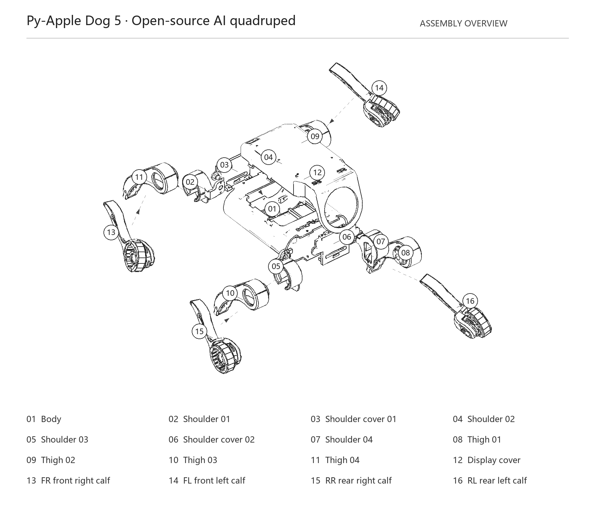

[简体中文](PRINTING.md) · **English**

# Printing and assembly

## Files and quantities

The `stl/` directory contains **16 print files**: one body, four shoulders, two shoulder covers, four thighs, one display top cover, and one complete lower-leg assembly for each of FR, FL, RR, and RL. Print each file once.

Numbers in the diagram match the [part index](exploded-index.en.json). See the [print list](print-list.en.csv) for filenames and dimensions. Parts are separated in the illustration for clarity; the actual mounting interfaces determine their assembly positions.

| Number | Abbreviation | Position |
| :---: | :---: | :---: |
| 13 | FR | Front right lower leg |
| 14 | FL | Front left lower leg |
| 15 | RR | Rear right lower leg |
| 16 | RL | Rear left lower leg |

Left and right are defined from the robot's perspective, facing forward.

## Print each lower leg as a complete assembly

Import each `*_calf_with_wheel_mm.stl` as one file. Preserve the relative positions of its parts; do not create separate print jobs for the two lower-leg pieces and wheel.

Each lower-leg STL contains **three separate closed shells** with the original assembly clearances. A single STL file does not mean the shells are fused. Inspect supports, moving clearances, and the formation of each shell in the slicer preview.

The four files are in [`stl/lower_legs/`](../stl/lower_legs/). Assemble them with **all four wheels facing outward**.

## Units and orientation

Import in **millimeters at 100% scale**. The lowest point of each file is at Z = 0. Placement has been adjusted without changing dimensions, hole sizes, or fitting clearances.

The body and upper parts start with their largest flat face downward. The lower legs retain their assembled arrangement. Choose orientation and supports for your material and printer, considering load direction, bridges, support removal, and holes. Test-print one leg and its mounting interfaces, then check the servo, horn, bearing, and axle fits before printing the complete robot.

## Geometry checks

- All 16 print files have closed meshes, consistent normals, and positive net volume.
- Each complete lower leg retains three closed shells with positive volume. The display top cover retains the enclosed internal cavity from the CAD model.
- Upper parts exported from STEP use 0.05 mm linear and 0.15 rad angular tessellation settings; volume deviation from the solid is below 0.06%.
- Lower-leg files preserve the original geometry, with placement adjustments only. See [mesh checks and hashes](mesh-validation.json).
- Mesh checks do not replace test prints, fit checks, load checks, assembly clearance checks, or policy adaptation.

## Record your test prints

Record the printer, nozzle, material, layer height, wall count, infill, supports, orientation, part mass, measured holes, and assembly results. Recheck simulation parameters and policy compatibility after changes to geometry or mass.

[Back to homepage](../README.en.md)
