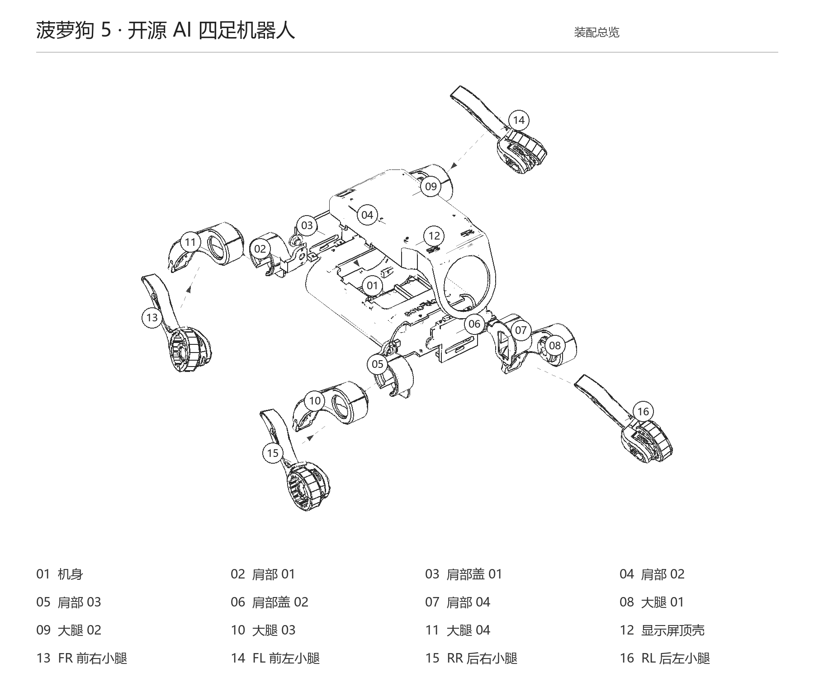

**简体中文** · [English](PRINTING.en.md)

# 打印与装配说明

## 打印文件与数量

`stl/` 共 16 个打印文件：机身 1、肩部 4、肩部盖 2、大腿 4、显示屏顶壳 1，以及 FR／FL／RR／RL 整体小腿各 1。每个文件打印 1 件或 1 组总成。

图中编号与 `exploded-index.json` 对应，文件与尺寸见 `print-list.csv`。爆炸图将零件拉开以便识别；小腿整体展示，示意摆放不代替实际安装接口和装配定位。

| 编号 | 缩写 | 英文 | 中文位置 |
| :---: | :---: | :---: | :---: |
| 13 | FR | Front Right | 前右小腿 |
| 14 | FL | Front Left | 前左小腿 |
| 15 | RR | Rear Right | 后右小腿 |
| 16 | RL | Rear Left | 后左小腿 |

左右以前进方向为准，按机器人自身朝向区分。

## 小腿整体打印

小腿使用四个 `*_calf_with_wheel_mm.stl`，整体导入切片软件，保持文件内各部分的相对位置，不再按小腿件 1、小腿件 2 和轮子分别列出打印任务。

每份原始小腿 STL 包含三个独立的闭合壳体，保留原有装配间隙。小腿以整体 STL 文件提供，保留轮子与小腿之间的间隙。请在切片预览中检查支撑、活动间隙和各壳体的成形情况；“整体文件”不表示几何上已经焊接为一个实体。

四个整体小腿文件统一放在 `stl/lower_legs/`，可用于查看装配关系和直接打印。

## 单位与摆放

导入时选择毫米、100% 比例。所有打印文件最低点已落到 Z=0，仅调整摆放位置，孔径、尺寸和原有配合间隙保持不变。

机身与上部结构以最大平面朝下作为初始姿态，小腿保留原装配关系并整体落地。请按实际材料和打印设备检查受力方向、悬空桥接、支撑可拆性和孔位。先试打一套单腿及安装接口，确认舵机、舵片、轴承与轮轴的配合，再打印全机。

## 几何检查

- 16 个打印文件中的网格均闭合、法向一致、净体积为正。
- 四个整体小腿文件各保留三个正体积闭合壳体；显示屏顶壳保留原 CAD 的封闭内腔。
- STEP 导出的上部结构采用 0.05 mm 线性离散参数、0.15 rad 角度参数，对照实体体积误差在 0.06% 内。
- 小腿打印文件仅调整摆放位置，保留原始几何；文件校验和见 `mesh-validation.json`。
- 网格检查不代替试打、孔位配合、受力、装配干涉及策略适配验证。

## 试打记录

记录打印机、喷嘴、材料与批次、层高、壁数、填充、支撑、摆放方向、零件称重、孔径实测与装配结果。涉及结构或质量变化时，重新核对仿真参数和策略对应关系。
