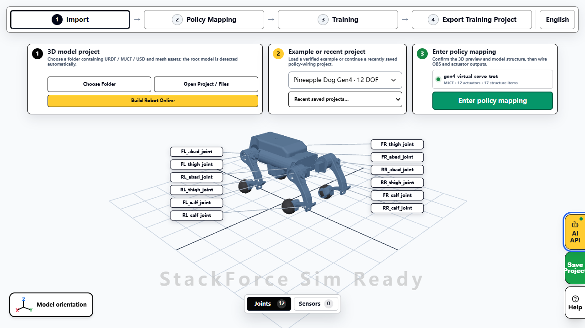

[简体中文](TRAINING.md) · **English**

# Train Py-Apple Dog 5 with SimReady

[Open StackForce SimReady](https://sim.stackforce.cc/) · [OpenSpark Lab's video introduction](https://www.bilibili.com/video/BV1kVRzBEE2g/)

SimReady brings the robot model, policy configuration, training, and replay into one browser workflow. The companion example appears in the English interface as **Pineapple Dog Gen4 · 12 DOF**. Load it to start learning without rebuilding a training model from STL files.

The [forward-gait training package](../training/README.en.md) also includes a `.simready` file. Choose **Open Project / Files** to load its robot, mappings, and training parameters.

## 1. Load the example

In **Import**, open the example list, select **Pineapple Dog Gen4 · 12 DOF**, and choose **Load Example**. Wait for the model and assets to finish loading. This is a different project from the historical 8-DOF and 12-DOF examples.

## 2. Inspect policy mapping

Open **Policy Mapping** and inspect the joint order, default pose, observation inputs, and action outputs. Keep the example configuration for your first run. Save a separate project before making changes so you can return to a reproducible starting point.

## 3. Connect the local runner

Open **Training**, download the runner for your operating system, start it, and connect it using the website instructions. Training runs on the computer hosting the runner. A CPU is suitable for a small workflow check; a compatible NVIDIA CUDA GPU allows larger runs within its available memory.

Start with **Run a small-scale check first** to check dependencies, logs, and model saving. Increase the training scale after that succeeds. Keep the runner running throughout training.

## 4. Train and inspect results

Start from the matching robot project and record the configuration and parameters. Monitor rewards, episode length, and logs. Replay saved checkpoints regularly to see whether the actual motion meets your goals.

Use curves and playback together: check standing stability, responses to motion commands, leg movements, and footfall patterns. Adjust parameters to address observed problems, then compare runs.

## 5. Save and replay

Use **Save Project** to retain the configuration and results, then replay the model in SimReady. The companion example uses custom observation channels. If the website reports that direct Sim2Sim handoff is unsupported, keep the full project and use training replay instead of substituting it into a different example.

Before physical deployment, match the mechanical structure, joint order, directions, zero positions, control period, action scaling, and wheel constraints to the training project. See [compatibility notes](COMPATIBILITY.en.md).

[Back to homepage](../README.en.md)
