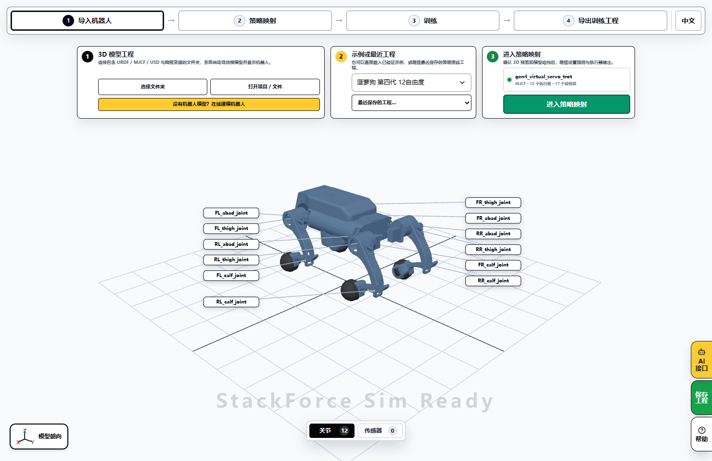

**简体中文** · [English](TRAINING.en.md)

# 用 SimReady 训练菠萝狗 5

[打开 StackForce SimReady](https://sim.stackforce.cc/) · [灯哥开源的视频介绍](https://www.bilibili.com/video/BV1kVRzBEE2g/)

SimReady 将机器人模型、策略配置、训练和回放放在同一个网页流程中。菠萝狗 5 的配套示例在网站中仍使用“菠萝狗 第四代 12自由度”名称，直接载入它即可开始学习，无需先从 STL 重建训练模型。

本地配套资料见[前行步态训练包](../training/README.md)：下载 `.simready` 文件后，也可以用“打开项目 / 文件”载入，模型、映射与训练参数已随工程保存。

## 1. 载入配套示例

在“导入机器人”页面打开示例列表，选择 **菠萝狗 第四代 12自由度**，点击 **加载示例**，等待模型和资源加载完成。它与列表中的历史“12自由度菠萝狗”“8自由度菠萝狗”是不同的工程。

## 2. 查看策略映射

进入 **策略映射**，查看示例的关节顺序、初始姿态、观测输入和动作输出。先沿用示例中的配置跑通完整流程，再逐项尝试修改。修改后另存工程，保留可复现的起点。

## 3. 连接运行器

进入 **训练**，从网页提供的入口下载适合当前系统的运行器，启动后按照提示与网页连接。训练计算在运行器所在的电脑上执行；CPU 适合先做小规模试跑，有兼容的 NVIDIA CUDA 显卡时可按显存容量增加训练规模。

首次使用可点击 **先做小规模验证**，以较少并行环境和较短训练轮数检查依赖、日志和模型保存是否正常，再增加训练规模。训练期间保持运行器工作。

## 4. 训练与检查结果

从当前菠萝狗工程开始训练，记录本次使用的配置和参数。观察奖励、回合长度与任务日志；定期选择保存的模型进行回放，结合实际动作检查是否达到预期。

训练曲线与机器人回放一起看：机器人是否能够站稳、响应运动指令，四条腿的动作与落足是否合理。需要继续调整时，针对观察到的问题修改配置，再比较不同实验的结果。

## 5. 保存与回放

使用 **保存工程** 保留本次配置和训练结果，并先在 SimReady 中回放模型。当前配套示例使用自定义观测通道；如网页提示尚不支持直接交接到 Sim2Sim，请保留完整工程并使用训练回放，不将其直接替换到其他示例中。

转入实机前，核对结构、关节顺序、方向、零位、控制周期、动作缩放以及轮子约束，与训练工程保持一致。具体对应记录见[机械与策略对应关系](COMPATIBILITY.md)。

[返回项目首页](../README.md)
