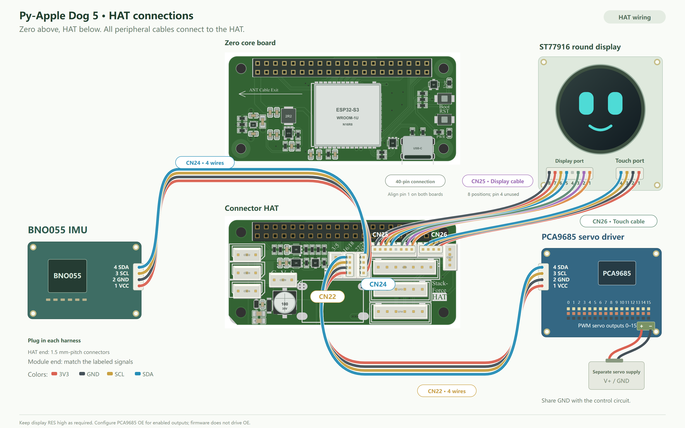

[简体中文](WIRING.md) · **English**

# Py-Apple Dog 5 · Hardware connections

[← Back to Step 2: Policy deployment](../README.en.md#diy-deploy)

Py-Apple Dog 5 uses an **ESP32-S3 Zero core board and Connector HAT**. The Zero runs the controller and connects to the computer over USB. **The BNO055, PCA9685, and round display all connect to the HAT**, which routes their power and signals.

## Wiring overview

Click the image to enlarge it. The diagram places the Zero above the HAT to make the ports easy to identify. **Connect matching pins of the 40-pin interfaces and align pin 1.** Disconnect power before fitting and securing the boards with the appropriate mating connectors, then attach the peripheral harnesses.

## 1. Connect peripherals to the HAT

| HAT port | Module | Harness |
| :---: | :---: | :---: |
| **CN24** | BNO055 IMU | 4 wires |
| **CN22** | PCA9685 servo driver | 4 wires |
| **CN25** | ST77916 round display | 8-position plug, 7 wires; pin 4 unused |
| **CN26** | CST816D touch interface | 4 wires |

The HAT uses **1.5 mm-pitch connectors**. Wire the module end according to its pin labels: match power, ground, and signal names. All pin numbers below are **electrical pin numbers on the HAT connector**; do not infer the order solely from the plug's apparent left/right orientation.

### BNO055 and PCA9685

| Pin | CN24 → BNO055 | CN22 → PCA9685 |
| :---: | :---: | :---: |
| 1 | 3V3 → Module power | 3V3 → Logic VCC |
| 2 | GND → GND | GND → GND |
| 3 | GPIO2 → SCL | GPIO21 → SCL |
| 4 | GPIO1 → SDA | GPIO47 → SDA |

Use a BNO055 module compatible with 3.3 V power and logic. Power **PCA9685 logic VCC and servo V+ separately**. Connect PWM servos to the corresponding PCA9685 channels and confirm the channel-to-joint mapping during calibration. The current firmware does not drive OE; configure it for enabled outputs according to the module's documentation.

### Round display and touch

| CN25 pin | HAT signal | Display connection |
| :---: | :---: | :---: |
| 1 | GPIO14 | BLC / Backlight control |
| 2 | GPIO10 | CS |
| 3 | GPIO9 | DC |
| 4 | GPIO8 | Leave disconnected in this setup |
| 5 | GPIO11 | MOSI / DIN |
| 6 | GPIO12 | SCLK / CLK |
| 7 | 3V3 | Module power |
| 8 | GND | GND |

The current firmware does not control the display reset pin. **Keep RES high as required by the display module.**

| CN26 pin | HAT signal | Touch connection |
| :---: | :---: | :---: |
| 1 | 3V3 | Module power |
| 2 | GND | GND |
| 3 | GPIO16 | SCL |
| 4 | GPIO15 | SDA |

## 2. Connect power and USB

1. **Controller:** Connect the computer to the Zero USB-C port with a USB data cable.
2. **Servo power:** Use a separate supply rated for your servos and connect it to PCA9685 servo **V+ / GND**. Do not power the servos through USB.
3. **Common ground:** Connect the grounds of the controller, PCA9685, BNO055, display, and servo supply.

## 3. Calibrate and deploy

Open [StackForce Sim2Real](https://sim2real.stackforce.cc/) and select a configuration matching the boards, peripherals, and policy. Confirm IMU communication, then calibrate the order, direction, zero position, and range of all 12 joints. Check individual joints, a single leg, and standing before uploading and running the policy.

**[Back to Step 2](../README.en.md#diy-deploy) · [View open hardware](../hardware/README.en.md)**
