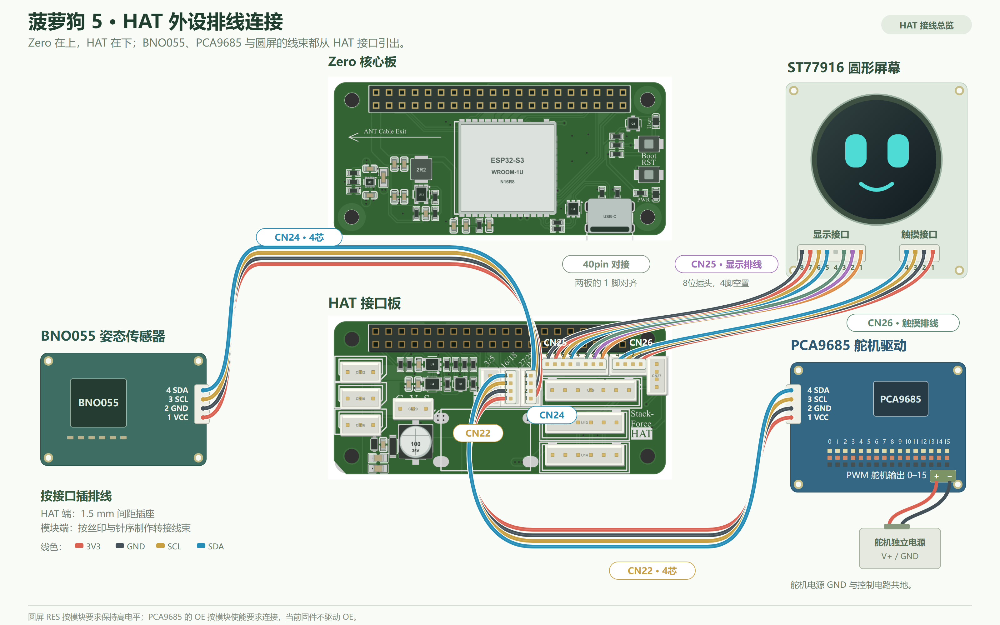

**简体中文** · [English](WIRING.en.md)

# 菠萝狗 5 · 硬件连接

[← 返回第二步：强化学习策略实物部署](../README.md#diy-deploy)

菠萝狗 5 使用 **ESP32-S3 Zero 核心板 + Connector HAT**。Zero 负责运行控制程序并通过 USB 连接电脑；**BNO055、PCA9685 和圆形屏幕都接到 HAT**，由 HAT 引出相应的电源与信号。

## 接线总览

点击图片可查看大图。图中将 Zero 放在上方、HAT 放在下方，方便辨认接口；两板通过 **40pin 接口同号对接，1 脚对齐**。连接时断开电源，按实际接插件装配并固定两块板，再接外设线束。

## 1. 将外设接到 HAT

| HAT 接口 | 连接模块 | 线束 |
| :---: | :---: | :---: |
| **CN24** | BNO055 姿态传感器 | 4 芯 |
| **CN22** | PCA9685 舵机驱动模块 | 4 芯 |
| **CN25** | ST77916 圆屏显示接口 | 8 位插头，接 7 根线，第 4 脚留空 |
| **CN26** | CST816D 圆屏触摸接口 | 4 芯 |

HAT 端使用 **1.5 mm 间距插座**。模块端按其丝印和针序连接：VCC 对电源、GND 对地，其余信号按名称对应。下表中的针号均指 **HAT 插座的电气针号**，不能仅凭插头正面看起来的左右顺序接线。

### BNO055 与 PCA9685

| 针号 | CN24 → BNO055 | CN22 → PCA9685 |
| :---: | :---: | :---: |
| 1 | 3V3 → 模块电源 | 3V3 → 逻辑 VCC |
| 2 | GND → GND | GND → GND |
| 3 | GPIO2 → SCL | GPIO21 → SCL |
| 4 | GPIO1 → SDA | GPIO47 → SDA |

BNO055 使用支持 3.3 V 电源与逻辑的模块。PCA9685 的 **逻辑 VCC 与舵机 V+ 分开供电**；PWM 舵机接到 PCA9685 的对应通道，通道与关节的对应关系在后续标定时确认。当前固件不驱动 OE，按所用模块的说明将 OE 配置为使能状态。

### 圆形屏幕与触摸

| CN25 针号 | HAT 信号 | 接到圆屏 |
| :---: | :---: | :---: |
| 1 | GPIO14 | BLC / 背光控制 |
| 2 | GPIO10 | CS |
| 3 | GPIO9 | DC |
| 4 | GPIO8 | 当前接法留空 |
| 5 | GPIO11 | MOSI / DIN |
| 6 | GPIO12 | SCLK / CLK |
| 7 | 3V3 | 模块电源 |
| 8 | GND | GND |

当前固件不控制屏幕复位脚；屏幕 **RES 按模块要求保持高电平**。

| CN26 针号 | HAT 信号 | 接到触摸接口 |
| :---: | :---: | :---: |
| 1 | 3V3 | 模块电源 |
| 2 | GND | GND |
| 3 | GPIO16 | SCL |
| 4 | GPIO15 | SDA |

## 2. 连接供电与 USB

1. **连接控制板**：用 USB 数据线连接电脑与 Zero 核心板的 USB-C 接口。
2. **连接舵机电源**：按舵机的额定电压配置独立电源，接至 PCA9685 的舵机 **V+ / GND**，不通过 USB 为舵机供电。
3. **确认共地**：控制板、PCA9685、BNO055、圆屏与舵机电源的 GND 保持相连。

## 3. 开始标定与部署

进入 [StackForce Sim2Real](https://sim2real.stackforce.cc/)，选择与板卡、外设和策略匹配的配置。先确认 IMU 通信，再完成 12 个关节的顺序、方向、零位与运动范围标定，依次检查单关节、单腿和站立，最后上传并运行策略。

**[返回第二步，继续部署](../README.md#diy-deploy) · [点击进入硬件开源查看](../hardware/README.md)**
