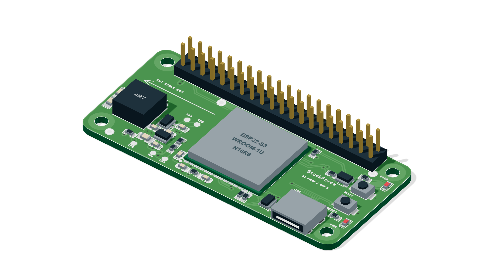
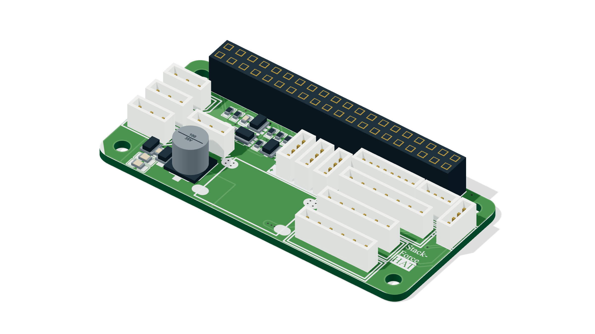

[简体中文](README.md) · **English**

# Py-Apple Dog 5 · Circuit schematics

Py-Apple Dog 5 uses the **StackForce ESP32-S3 Zero core board and Connector HAT, revision RevB**.

| Board | Schematic | Role |
| :---: | :---: | :---: |
| ESP32-S3 Zero core board RevB | [Download core schematic](schematics/SCH_ESP32-S3-Core-RevB_2026-09-17.pdf) | ESP32-S3 controller, power, USB, and 40-pin interface |
| Connector HAT RevB | [Download HAT schematic](schematics/SCH_Connector-HAT-RevB_2026-09-17.pdf) | Signal and logic-power distribution for external modules |

The core board uses an **ESP32-S3-WROOM-1U-N16R8**, with 16 MB flash and 8 MB PSRAM. With matching firmware, an IMU, servo interfaces, and power, compatible motion policies can run on the low-cost ESP32 controller.

The HAT connects external modules such as an IMU, PCA9685, or servo-bus adapter; these functions are not all integrated into the two boards. Servo power uses a separate distribution harness rather than logic-signal connectors.

## Build your own core board and HAT

To manufacture these boards or use them in your own robot, visit **[StackForce ESP32 Zero](https://github.com/Deng-ge-open-source/StackForce-ESP32-Zero)**. PCB manufacturing files, schematics, pinout diagrams and assembly instructions are organized there to help you move from connecting peripherals to **building your own controller**.

<table align="center">
<tr><th align="center">ESP32 Zero core · September 2026</th><th align="center">Connector HAT · October 2026</th></tr>
<tr><td width="50%" align="center"></td><td width="50%" align="center"></td></tr>
</table>

3D illustrations use the actual PCB layout and component coordinates with simplified component bodies. Click either image to enlarge.

### Raspberry Pi Zero peripherals, powered by ESP32

- **Reuse an established peripheral ecosystem:** the **nominal 65 × 30 mm outline and 40-pin, 2.54 mm expansion format** support reuse of common **3.3 V I²C, SPI and UART sensors, displays and controller modules** from the **Raspberry Pi Zero and Radxa ZERO 3W** ecosystems.
- **Keep connections together:** Zero handles computation and control, while the Connector HAT brings out interfaces for the orientation sensor, servo controller and round display.
- **Build your own controller:** **Gerber, drill files, BOM, placement data and manufacturing instructions** support PCB fabrication and assembly.

See the [pinout](https://github.com/Deng-ge-open-source/StackForce-ESP32-Zero/blob/main/docs/PINOUT.md) and [wiring guide](https://github.com/Deng-ge-open-source/StackForce-ESP32-Zero/blob/main/docs/WIRING.md) for connector assignments and ESP32 GPIO settings.

<a href="https://github.com/Deng-ge-open-source/StackForce-ESP32-Zero"><b>Explore StackForce ESP32 Zero · DIY hardware files →</b></a>

**[Zero pinout and HAT wiring guide](../docs/WIRING.en.md)**

Earlier Py-Apple Controller schematics remain under [previous versions](../legacy/README.en.md), separate from this RevB hardware.

[Back to homepage](../README.en.md)
