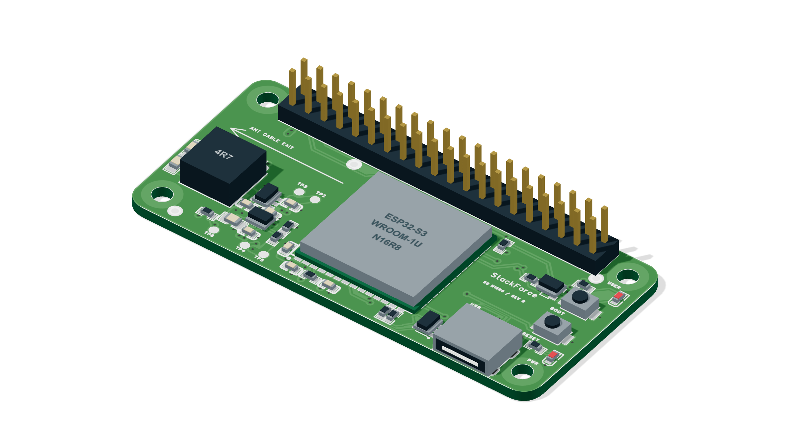
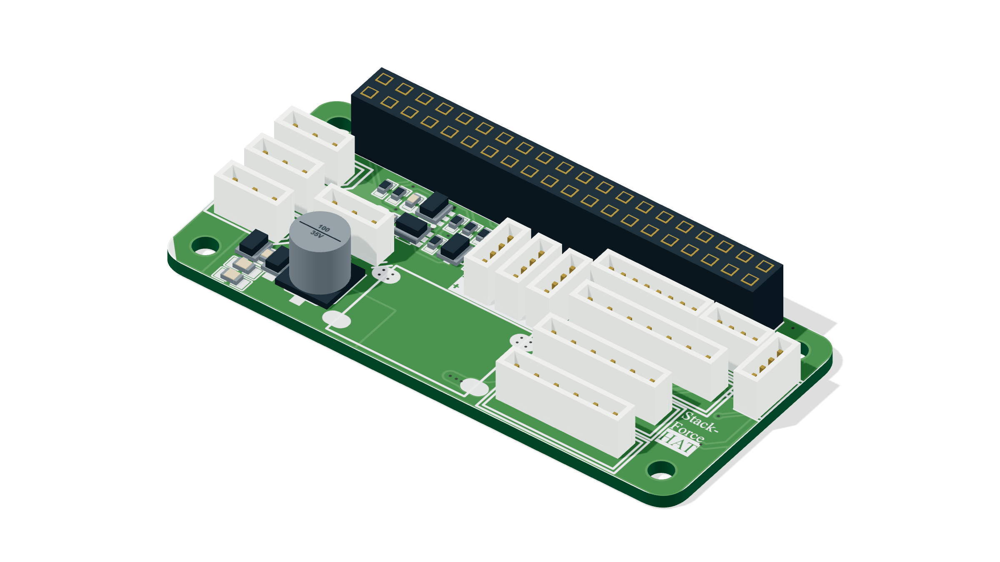

**简体中文** · [English](README.en.md)

# 菠萝狗 5 · 电路原理图

菠萝狗 5 使用 **StackForce ESP32-S3 Zero 核心板 + Connector HAT，RevB 版本**。

| 板卡 | 原理图 | 作用 |
| :---: | :---: | :---: |
| ESP32-S3 Zero 核心板 RevB | [下载核心板原理图](schematics/SCH_ESP32-S3-Core-RevB_2026-09-17.pdf) | ESP32-S3 主控、电源、USB 与 40pin 接口 |
| Connector HAT RevB | [下载 HAT 原理图](schematics/SCH_Connector-HAT-RevB_2026-09-17.pdf) | 外接模块的信号与逻辑电源分配 |

核心板采用 **ESP32-S3-WROOM-1U-N16R8**，配置 16 MB Flash 和 8 MB PSRAM。配合适配的固件、IMU、舵机接口与供电，可在低成本 ESP32 主控上部署匹配的运动策略。

HAT 连接外接 IMU、PCA9685 或舵机总线转换模块等外设；这些功能模块并非全部集成在核心板或 HAT 上。舵机功率供电使用独立配电线束，不经逻辑信号接口供电。

## 自己 DIY 核心板与 HAT

想亲手制作这两块板，或把它们用在自己的机器人上，可以进入独立的硬件项目 **[StackForce ESP32 Zero](https://github.com/Deng-ge-open-source/StackForce-ESP32-Zero)**。PCB 制造文件、原理图、引脚图与装配说明统一在该仓库整理，方便你从使用外设进一步走向**自造控制板**。

<table align="center">
<tr><th align="center">ESP32 Zero 核心板 · 2026-09</th><th align="center">Connector HAT · 2026-10</th></tr>
<tr><td width="50%" align="center"></td><td width="50%" align="center"></td></tr>
</table>

三维示意图依据实际 PCB 布局与元件坐标绘制，元件外观为简化示意；点击可查看大图。

### 树莓派 Zero 的外设，ESP32 来驱动

- **复用成熟的外设生态**：采用 **65 × 30 mm 标称板框与 40 针、2.54 mm 扩展接口形式**，可复用**树莓派 Zero 和瑞莎 Radxa ZERO 3W**平台常用的 **3.3 V I²C、SPI、UART 传感器、显示屏和控制模块**。
- **连接更集中**：Zero 负责计算与控制，Connector HAT 将外设接口集中引出，方便连接姿态传感器、舵机控制模块和圆形屏，减少为每种外设单独设计转接电路的工作。
- **支持自造控制板**：提供两块板的 **Gerber、钻孔文件、BOM、贴装坐标和制造说明**，便于交给工厂制作 PCB 或进行贴装，逐步完成自己的控制板。

接口分配和 ESP32 程序使用的 GPIO 见新仓库的[引脚图](https://github.com/Deng-ge-open-source/StackForce-ESP32-Zero/blob/main/docs/PINOUT.md)与[外设接线](https://github.com/Deng-ge-open-source/StackForce-ESP32-Zero/blob/main/docs/WIRING.md)。

<a href="https://github.com/Deng-ge-open-source/StackForce-ESP32-Zero"><b>进入 StackForce ESP32 Zero · 查看 DIY 硬件资料 →</b></a>

**[Zero 引脚图与 HAT 接线说明](../docs/WIRING.md)**

旧版 Py-Apple Controller 的电路资料保留在[历史版本](../legacy/README.md)，与此处的 RevB 分开记录。

[返回首页](../README.md)
